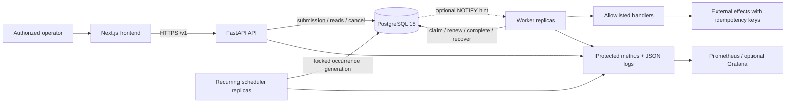
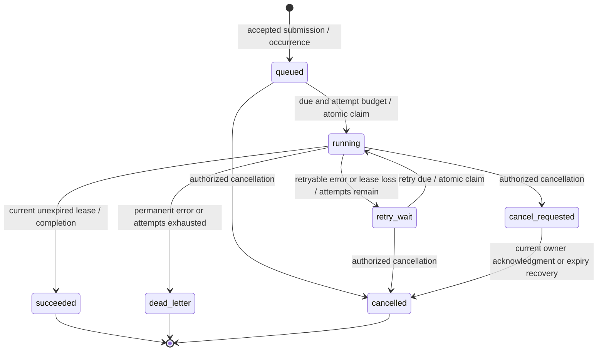

# Chronos technical design

Status: Phase 3, 2026-10-27. The transactional queue and independent workers are implemented;
the worker lifecycle, isolation and failure limits are documented in docs/WORKER_RUNTIME.md.
The detailed
runtime protocol and exact SQL are in docs/database/TRANSACTIONS.md and take
precedence over the original design sketches below. Recurring generation,
authenticated HTTP APIs and deployment remain later-phase designs.
See docs/PROJECT_STATE.md for verification evidence.

## Scope and assumptions

Chronos accepts typed jobs, persists scheduling intent, executes trusted registered
handlers in independent workers, and exposes operational history. PostgreSQL 18 is
the sole coordination authority. One writable database primary serves one deployment;
no active-active database writes, cross-region consensus, or untrusted code execution.
Target scale is initially hundreds to thousands of queued jobs. Throughput is measured
in Phase 6, not promised. Database availability, eventual healthy workers, valid handlers,
and sufficient capacity are prerequisites for eventual execution.

Python 3.14, FastAPI, Pydantic 2, SQLAlchemy 2.x, psycopg 3, and Alembic form the
backend. Node 24, Next.js, React, TypeScript, and Tailwind form the frontend. Add
shadcn/ui components when actual dashboard interactions require them in Phase 5.
The resolved versions live in uv.lock and frontend/package-lock.json. No Redis or
external queue is needed. Railway is the planned deployment target; no cloud
resources are provisioned in this phase.

## Architecture and component contracts



| Boundary | Owns | Must not own |
| --- | --- | --- |
| API | validation, auth, quotas, idempotent submission, read/cancel contracts | long-running execution or recurrence loops |
| Engine | parameterized SQL, state invariants, transaction/retry policy | HTTP concerns or handler-specific external effects |
| Workers | bounded execution, heartbeat, timeout, recovery loop, graceful shutdown | accepting arbitrary code or HTTP-triggered background tasks |
| Scheduler | recurring intent, occurrence cursor and bounded catch-up | executing handlers |
| Observability | real counters, histograms, redacted logs, audit events | authoritative scheduling or high-cardinality metric labels |
| Frontend | accessible data views, forms, errors, polling, themes | database credentials, direct SQL, invented metrics |
| Migration job | schema changes before compatible application rollout | running migrations independently in every replica |

## Delivery, consistency and failure model

Delivery is at-least-once for jobs that remain eligible and have attempts left;
bounded retries intentionally terminate eventual attempts at dead-letter state.
Only one current lease exists per job row. An expired execution can physically
continue while another attempt runs: fencing protects Chronos state, not arbitrary
remote side effects. The external destination must enforce a business idempotency
key or monotonically increasing generation; alternatively use a transactional outbox
for same-database effects. Exactly-once external effects are not guaranteed.

API acceptance means the submission transaction committed, not that execution
started. A connection loss during COMMIT has an ambiguous outcome: the client
retries the same idempotency key; workers re-read ownership and never assume rollback.
Primary durability depends on PostgreSQL fsync/synchronous_commit and the provider's
replication/failover policy. A failover that loses acknowledged transactions can lose
accepted jobs or repeat effects. Restore from backup can replay already executed jobs.

Processes can crash, pause, lose connectivity, or receive SIGTERM at any point.
Database time governs due times and lease expiry. NTP/database clock steps can still
shift expiry and produce duplicate execution, so database-clock monitoring matters.
HTTP/network calls, execution, payloads, output, queues, and concurrency are bounded.
No universal deadlock-free or fairness claim is made. PostgreSQL outage stops claims;
workers stop effects when ownership cannot be confirmed and fail closed on renewal.

## Job state machine

`queued` covers both immediately due and future scheduled jobs. `retry_wait` carries
the next eligible timestamp. `running` means leased, including the short interval
before handler start. Attempt count increments on claim, even if the worker dies
before invoking the handler. Terminal states never reopen; replay creates a new job.



All other transitions are forbidden. Renewal is a same-state mutation only in running
or cancel_requested; the latter instructs the worker to stop rather than continue work.
Completion after cancellation request is rejected, so successful external effects can
coexist with cancelled status; cancellation means no further scheduled attempts, not
undoing prior effects. Cancellation and completion serialize on the job lock: first
committer wins the applicable transition. Terminal cancellation requests return the
existing state without mutating it. Schedule enable/disable is separate from job state.

## Transactions, locking and claiming

Default isolation is READ COMMITTED. Each mutation uses conditional writes plus row
locks; a read outside a transaction never authorizes a later write. A claim locks at
most the number of immediately free execution slots, using a bounded CTE and
`FOR UPDATE SKIP LOCKED`, then updates the job and inserts the corresponding
attempt and audit event in the same transaction. Execution begins only after COMMIT.
No network effect happens while a row lock is held.

```sql
-- Design sketch; parameters are bound, not string-interpolated.
WITH candidates AS (
  SELECT id FROM jobs
  WHERE queue = :queue AND state IN ('queued', 'retry_wait')
    AND available_at <= statement_timestamp() AND attempts < max_attempts
ORDER BY priority DESC, available_at, id
  LIMIT :free_slots FOR UPDATE SKIP LOCKED
)
UPDATE jobs AS j SET state = 'running', attempts = attempts + 1,
  generation = generation + 1, lease_token = gen_random_uuid(),
  lease_owner = :worker_id,
  lease_expires_at = statement_timestamp() + :lease_interval,
  updated_at = statement_timestamp()
FROM candidates AS c WHERE j.id = c.id
RETURNING j.*;
```

Insert `attempts(job_id, generation, lease_token, owner, started_at)` from returned
rows before committing. The key `(job_id, generation)` is unique. A random UUID
prevents accidental ownership reuse; the generation increases on every claim and
never resets. Neither worker ID nor job ID alone is sufficient authorization.

Completion/renewal/failure first acquire the job row lock in a short transaction,
then issue a conditional update with state, token, generation, and
`lease_expires_at > clock_timestamp()` predicates. Evaluating clock time after lock
acquisition avoids authorizing with a timestamp captured before waiting on the lock.
Zero affected rows means lost ownership, expired lease, or invalid transition.
Attempt finalization and audit events commit atomically with the job mutation.
COMMIT can be delayed after a valid mutation; competing reapers still serialize on
the same row and see the committed state. No wall-clock execution exclusivity follows.

Lock ordering: schedule row (generation only), then job rows in ascending UUID order,
then attempts, then events. Job mutators never lock schedules after jobs. Recovery
batches lock jobs in ascending UUID order with SKIP LOCKED. Claim candidates are
ordered by eligibility; those transactions only take independent job locks and then
their child rows. Retry deadlocks (40P01) and serialization errors (40001) by replaying
the whole DB-only transaction with bounded jitter. Bound statement and lock timeouts.

## Leases, retries and crash recovery

Initial design defaults: 30 s lease, renewal every 10 s, recovery poll every 2 s,
claim poll with jitter up to 1 s idle delay, per-job execution timeout at most 15 min.
Values are configurable and must be validated under fault injection. Use a separate
connection for renewal so a busy execution never blocks its heartbeat.

On SIGTERM stop claiming, drain bounded work within 20 s, then cancel handlers and
let unacknowledged leases expire. Never release a lease while a handler may still
perform effects. Synchronous/blocking handlers require process isolation before
support; initial supported handlers must cooperate with async cancellation.

Each worker runs a bounded recovery loop; multiple loops safely compete on expired
running/cancel_requested rows. After locking, recheck expiry with DB clock. Mark the
active attempt lease_expired; running goes to retry_wait or dead_letter according
to attempt budget, and cancel_requested goes to cancelled. Clear lease fields on
exit from leased states. Old heartbeat/completion calls fail their predicates.

Retryable timeouts and selected transient failures use full jitter:
`delay = uniform(0, min(300 seconds, 1 second * 2^(attempts-1)))`, bounded to prevent
overflow. Use DB time plus the sampled duration. Default max_attempts = 5 including
the first attempt. Validation/unknown-handler errors are permanent. A failure to
persist an error is recovered by lease expiry; it does not authorize an unowned retry.
No manual retry mutates a terminal job: replay makes a linked new job with a new key.

## Recurring scheduling

A dedicated scheduler process is justified by independent lifecycle, catch-up control,
and avoiding recurrence running once in each API process. It is not a singleton:
replicas use short schedule-row locks with SKIP LOCKED. Within one transaction,
read a bounded number of due schedules, insert occurrences and jobs, and advance
`next_fire_at`. Unique `(schedule_id, revision, scheduled_for)` prevents duplicate
generation on replay. Cursor rollback and job rollback happen together. Occurrence
records outlive job retention, preserving deduplication.

Initially support fixed UTC intervals only; cron/timezone/DST semantics are deferred.
Default misfire policy skips backlog except the latest due slot, recording skipped
count; optional catch_up emits at most 100 occurrences per schedule transaction and
leaves remaining work for later ticks. Cursor arithmetic derives slots from the prior
cursor, never from the scheduler host clock. An edit locks the schedule, increments
revision, and sets a new future cursor; already generated jobs remain. Disable stops
future generation only. See ADR-0003 for constraints.

## Data and API contracts

See docs/database/README.md for relational design, SQL constraints/indexes and
retention, and docs/API.md for proposed HTTP contracts. Tenant scoping is explicit
in API keys, jobs, schedules and read queries. Workers are trusted infrastructure
with DB credentials, never exposed as public worker-control endpoints.

## Observability and capacity

Emit structured JSON events with event name, request/job/attempt/worker IDs,
generation, queue, duration, and error class; never payloads, API keys, or raw
exception messages that contain credentials. Metrics label only bounded queues,
outcomes and job types. Track real claim/renewal/completion latency histograms,
queue age, throughput, lease expiry/reclaim lag, retries/dead letters, scheduler lag,
pool utilization, DB lock waits, and process CPU/RAM. Protect /metrics separately.
Liveness is process-only; future readiness performs bounded SELECT 1 and migration
revision validation. Current foundation exposes liveness only.

Start with 5 API connections + 2 per worker + 2 scheduler + one notification listener
per process if enabled. Explicitly budget every replica below provider max_connections,
with operational/migration headroom. LISTEN requires a dedicated session connection,
not transaction-pooled PgBouncer. Polling remains mandatory after reconnect/startup.
NOTIFY carries only a queue hint and can be lost; it never contains job payloads.

FIFO is approximate: SKIP LOCKED and multiple workers reorder starts and completions.
Phase 2 supports integer priorities, descending before eligibility time; sustained high
priority traffic can starve low priorities. The planned worker loop will serve configured
queues round-robin with per-queue concurrency and admission quotas to limit starvation.
Monitor oldest age; reject submission at quota with 429. Tune indexes using EXPLAIN
(ANALYZE, BUFFERS) on representative load, monitor autovacuum and dead tuples, and
archive terminal rows in small batches. No partitioning until measured need.

## Verification and rollout

Phase 1 checks formatting, types, liveness contract, production frontend build and
proposed DDL on real PostgreSQL in CI. It does not establish runtime queue guarantees.
Phase 2/3 prove claim/fencing/crash invariants using independent connections and
barriers, and Phase 4 tests recurrence duplication and edit races. Phase 6 measures
load on documented hardware. Migrations use expand/contract changes, staging backup
restore rehearsal, and one migration job; application rollback requires schema
compatibility. Cloud provisioning/costs require explicit approval before Phase 7.

## Sources

The PostgreSQL decisions are derived from the official documentation reviewed in
docs/POSTGRESQL_RESEARCH.md. ADRs record the alternatives and consequences.
