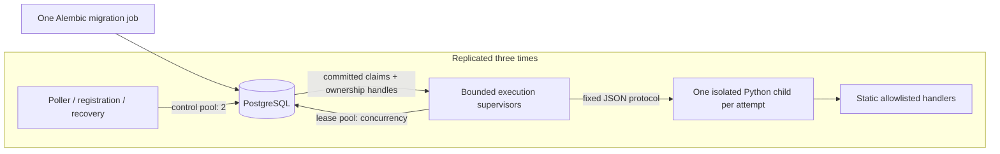

# Phase 3 independent distributed workers

`python -m chronos.worker` is a standalone Python service. It neither imports nor
starts FastAPI. Compose runs worker-1, worker-2 and worker-3 as separate containers
and process trees, coordinated only by PostgreSQL. A single migration service must
complete before they start. Phase 4 now requires schema revision 0003; its additional
recovery/retry/audit contracts and opt-in independent effect demonstration are in
FAULT_TOLERANCE.md. The rest of this document records the Phase 3 runtime baseline.



## Execution lifecycle

1. Validate configuration and migration revision; register a fresh worker UUID and
   heartbeat token. Renew registration separately from job leases.
2. Recover a bounded batch of expired attempts and poll with jitter. Claim no more
   jobs than the currently free concurrency slots, using the Phase 2 atomic SQL.
3. Revalidate/renew each claim after commit before dispatch. Record execution start
   in its attempt and job/audit history under the same owner predicates.
4. Start a fixed `sys.executable -m chronos.worker.execute` child with JSON data.
   The module and executable are constant, shell=False, and the handler map is static.
   No payload field can choose an import, command, path, URL or executable.
5. Independently renew leases while the child runs. Success persists a bounded JSON
   result and closes the attempt/job/events atomically through fenced acknowledgment.
   Permanent errors dead-letter; transient failures use the existing bounded jitter
   retry policy. Unknown handlers are permanently rejected before child dispatch.
6. On uncertain/lost renewal, stop/reap the child and abandon the attempt. If the
   cause was cancellation, acknowledge cancellation only after the child has stopped
   and only while ownership is still valid. Otherwise recovery handles the lease.

The dispatcher start timestamp marks the parent's verified dispatch boundary;
`handler_spawned` records creation of the child. It does not assert that arbitrary
external effects started at exactly that timestamp. All authoritative scheduling,
lease and attempt timestamps are database time.

## Lease and failure safety

Renewal returns remaining lease and execution budget measured in PostgreSQL. The
supervisor builds a conservative monotonic deadline from **request dispatch time**,
subtracting a 250ms margin. Commit/network delay therefore cannot extend its local
estimate. Database identity/generation/token/state/expiry predicates remain decisive.
An unusable initial window never dispatches a handler. A per-attempt execution
deadline caps renewals and child runtime; process startup consumes that budget too.

Control-plane and lease/finalization operations use separate bounded thread pools
and connection pools so handler CPU work and saturated lease calls do not starve
worker heartbeats. Handlers run in OS children, not those DB threads. IPC input,
output, workload size, process count and execution time are bounded. Child stderr
is discarded; the fixed protocol exposes bounded error codes, never tracebacks.
Only a small runtime environment is forwarded to children, without DB credentials.

Cancelling an awaited thread operation does not cancel a DB transaction already
running in that thread. Its outcome is treated as ambiguous. A lost claim response
never starts guessed work; unreturned claims expire. Uncertain finalization never
restarts effects within the same supervisor. Reapers eventually retry/dead-letter
according to the attempt budget. Connectivity retries use capped exponential jitter;
they do not promise eventual success during a permanent outage. Database calls retain
the Phase 2 connection/pool/statement/lock timeouts. Repeated infrastructure failures
can consume attempt budgets even when no handler ran; that is an explicit limitation.

SIGTERM/SIGINT stop polling immediately and mark the registration draining. Claims
already in flight may commit but are abandoned before dispatch if shutdown was
requested. Existing children continue with lease renewal for the configured grace
budget. After that budget, they are killed/reaped and leases are left for recovery;
the runtime never releases a lease while its child might still run. The registration
is marked stopped when possible; failed writes fall back to heartbeat expiry.
Compose gives 35s for the default 20s drain plus bounded DB/cleanup operations.

On SIGKILL no cleanup runs. Linux children request parent-death SIGKILL and check
the parent identity to cover startup races; Docker also tears down container process
trees. Native Windows uses a parent-process wait handle; other platforms use a
parent-identity watchdog. Full signal/outage tests run in Linux containers, including
when the host is Windows. Native non-Linux forced-parent-death behavior is not certified
by those tests. No process isolation is a security sandbox for untrusted code:
only trusted built-in handlers are permitted.

At-least-once effects remain possible after a pause, DB clock step, network partition,
ambiguous completion or crash. Fencing protects Chronos state; a real remote effect
must enforce its business idempotency key or destination fencing. Notification
delivery here is explicitly simulated, without email/SMS/network side effects.

## Workloads and result contract

| Registered type | Bounded data and actual result |
| --- | --- |
| image_metadata | Base64 PNG <=60,000 characters; extracts width/height/depth/color/byte count/SHA256, validates chunk bounds/CRCs. Does not decode pixels or claim full PNG semantic validation. |
| csv_transform | CSV <=40,000 characters, <=2,000 rows and 50 columns; validates shape and finite bounded decimal amounts, normalizes amounts to two decimals, returns transformed CSV and total. No formulas are evaluated. |
| synthetic_report | <=10,000 seeded synthetic rows; returns actual bucket counts, aggregate and SHA256. |
| notification | Bounded recipient identifier; deterministic receipt/business delivery key. Optional bounded simulated transient/reject disposition demonstrates retries and permanent errors. |

Each workload allows an explicit 0..60s delay for observable demos/fault injection.
Extra payload fields are rejected. No job uses arbitrary files, fetches URLs, opens
sockets, invokes shells, or evaluates user code. Outputs are capped at 60,000 UTF-8
JSON bytes and stored only in succeeded attempts (DB cap 64 KiB). Results may contain
job data such as CSV values; tenant authorization is required before exposing them
through the future API. Payloads, results, tokens, credentials and exception messages
are excluded from worker lifecycle logs. SQLAlchemy pool reset tracebacks are suppressed
in favor of structured redacted database-failure events.

## Configuration and reproduction

Configure a URL in CHRONOS_DATABASE_URL or use PGHOST/PGPORT/PGUSER/PGDATABASE/PGPASSWORD.
Compose uses connection fields so passwords containing URL-special characters work.
Never commit credentials. For production use platform secret storage and a dedicated
least-privilege runtime DB role; the local Compose superuser is development-only.

Settings use the CHRONOS_WORKER_ prefix:

| Suffix | Default | Bounds / purpose |
| --- | --- | --- |
| NAME / QUEUE | chronos-worker / default | Registration label / one queue |
| CONCURRENCY | 4 native; 2 Compose | 1..32 children, claim only free slots |
| ALLOWED_HANDLERS | All four registered built-ins | Nonempty subset of the static registry |
| LEASE_SECONDS / RENEW_INTERVAL_S | 30 / 5 | Lease 3..300; renewal <=lease/3 |
| HEARTBEAT_INTERVAL_S / WORKER_TTL_SECONDS | 5 / 60 | Heartbeat <=TTL/3; TTL 3..3600 |
| POLL_INTERVAL_S / RECOVERY_INTERVAL_S | 0.5 / 2 | Jittered poll; bounded recovery batches |
| DB_CALL_TIMEOUT_S | 2 | 0.1..5; must leave lease safety margin |
| SHUTDOWN_GRACE_S | 20 | 0..120; increase Compose stop_grace_period if raised |

With .env configured as described in README.md:

```sh
docker compose --profile workers up -d --build postgres migrate worker-1 worker-2 worker-3
docker compose exec -T worker-1 .venv/bin/python -m chronos.worker.demo seed --count 12 --delay 2
docker compose logs -f worker-1 worker-2 worker-3
docker compose exec -T worker-1 .venv/bin/python -m chronos.worker.demo status
docker compose stop worker-1 worker-2 worker-3
```

The demo CLI is trusted local operator tooling, not an unauthenticated API. Seed
prints only tenant/job IDs; status prints aggregate real DB states. Existing work
is retained in PostgreSQL. SIGKILL experiments are destructive to running demo
attempts and are automated only against UUID-named disposable test projects.

Native service: apply Alembic head, set connection environment, then
`uv run --no-sync python -m chronos.worker`. Worker CPU/memory limits are enforced
by Compose (512 MiB, 128 PID limit per worker); native execution needs equivalent
service-manager limits. Budget DB connections as 2+concurrency per worker plus API,
migrations and operator headroom. No production throughput benchmark exists yet.

## Verification

Database/runtime suite: set CHRONOS_TEST_DATABASE_URL and CHRONOS_REQUIRE_DB=1,
then `uv run --no-sync pytest -q -m "not compose"`.

Linux process suite: build the worker image, set CHRONOS_RUN_COMPOSE_TESTS=1, then
`uv run --no-sync pytest -q -m compose tests/process`. It creates only UUID-named
test projects, uses random free ports, and removes its own containers/volumes.
Condition polling waits for durable DB/log observations; fixed sleeps do not order
claims or simulate process crashes. SIGTERM, SIGKILL and PostgreSQL stop/start are real.

The worker-processes CI job runs these tests and uploads redacted JSON lifecycle
logs, facts and JUnit output as worker-process-evidence. See PHASE3_VERIFICATION.md.
Official references: [Python subprocess management](https://docs.python.org/3.14/library/asyncio-subprocess.html),
[asyncio cancellation/timeouts](https://docs.python.org/3.14/library/asyncio-task.html),
[Compose startup ordering](https://docs.docker.com/compose/how-tos/startup-order/) and
[Compose service shutdown](https://docs.docker.com/reference/compose-file/services/#stop_grace_period).
