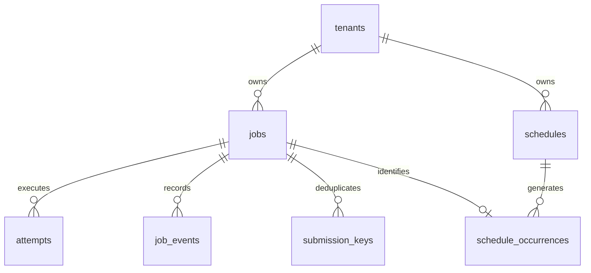

# Database design proposal

`proposal.sql` is executable PostgreSQL 18 DDL, tested in an isolated transaction.
It is not installed by Docker initialization or Alembic yet. Phase 2 promotes the
reviewed design into a versioned migration alongside transaction-level tests.

| Table | Authority and constraints |
| --- | --- |
| tenants | Explicit resource scope; initial deployment can use one tenant. |
| jobs | Current state, attempt budget, eligibility, generation and lease tuple. All timestamps timestamptz/UTC. Lease tuple exists iff leased; finished_at iff terminal. |
| attempts | Immutable identity `(job_id,generation)` and unique token; outcome recorded once under job lock. Retain error code, no raw payload/traceback. |
| schedules | Fixed UTC interval, revision, enabled flag, next cursor, template and misfire policy. |
| schedule_occurrences | Unique `(schedule_id,revision,scheduled_for)` and unique job identity; cross-tenant references forbidden by composite FKs. |
| submission_keys | Tenant-scoped request hash/key to job mapping for atomic idempotent submission. Hash canonical validated request including defaults. |
| job_events | Append-only logical state history with actor and generation; DB permissions prohibit arbitrary application deletion. |

Phase 2 adds hashed API keys with key prefix, tenant, roles, revoked_at and expiry;
schedule-creation idempotency storage is also required before its HTTP endpoint.
Worker identities are UUIDs assigned at process start; no durable worker table is
needed for ownership correctness. Worker presence can later be a separate advisory view.

Claim partial B-tree `(queue,available_at,id)` matches literal eligible states;
recovery index finds expired leases; tenant history supports pagination; schedule
index finds enabled due cursors. Indexes never contain time-dependent predicates.
Due-time range scans and sorting must be measured; no full payload GIN index without
a justified query. PostgreSQL bloat from frequent renewals requires autovacuum tuning
and tracking write amplification; payload splitting is deferred until measured.

DB CHECK constraints enforce row shape, not all legal transitions or monotonic
generation across updates. Engine code and restricted DB roles enforce mutation
protocols; integration/concurrency tests must prove them before runtime release.
Claim, attempt and event writes share one transaction. Completion likewise finalizes
the attempt and event with the state change. Any error rolls back all three.

Initial retention target: terminal history 30 days, idempotency keys at least 30 days
and while the job exists; never delete an occurrence deduplication record while its
schedule can revisit that occurrence. Initial proposal uses restrictive foreign keys,
so no automatic purge exists. A future retention migration must detach occurrence job
references (keeping immutable occurrence identity), then remove events/attempts/keys
and handle replay references before deleting jobs. Keep archival batch transactions
short. Schedule hard deletion is disallowed initially; disable instead.

No RLS claim is made: tenant authorization lives in API query predicates and service
tests initially; trusted workers span tenants. Separate migration owner and runtime
roles in Phase 2/7. Database credentials are never issued to frontend users.
